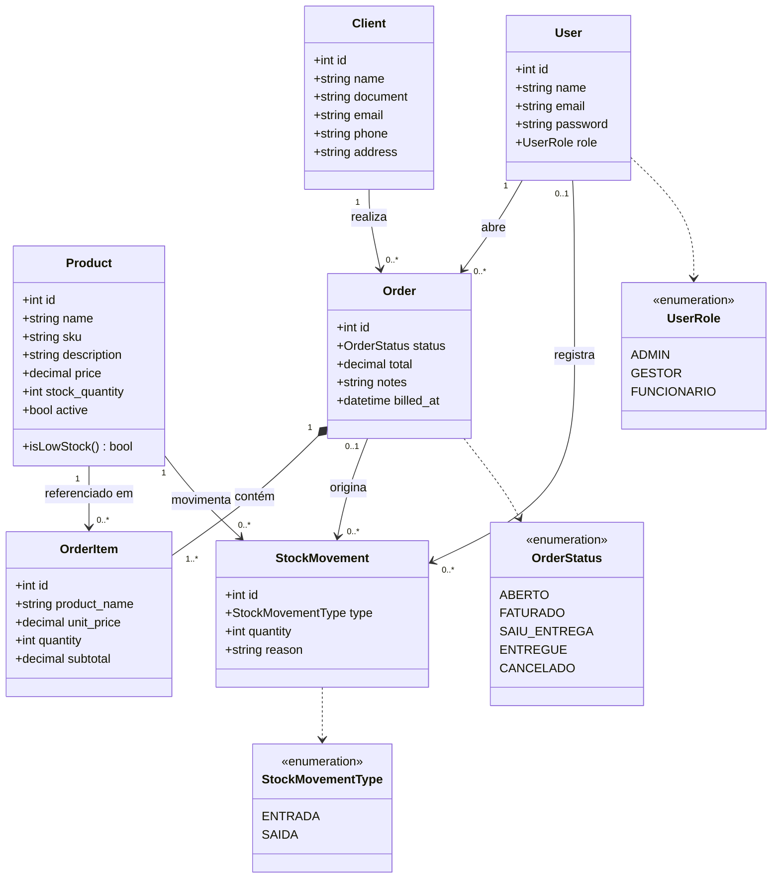
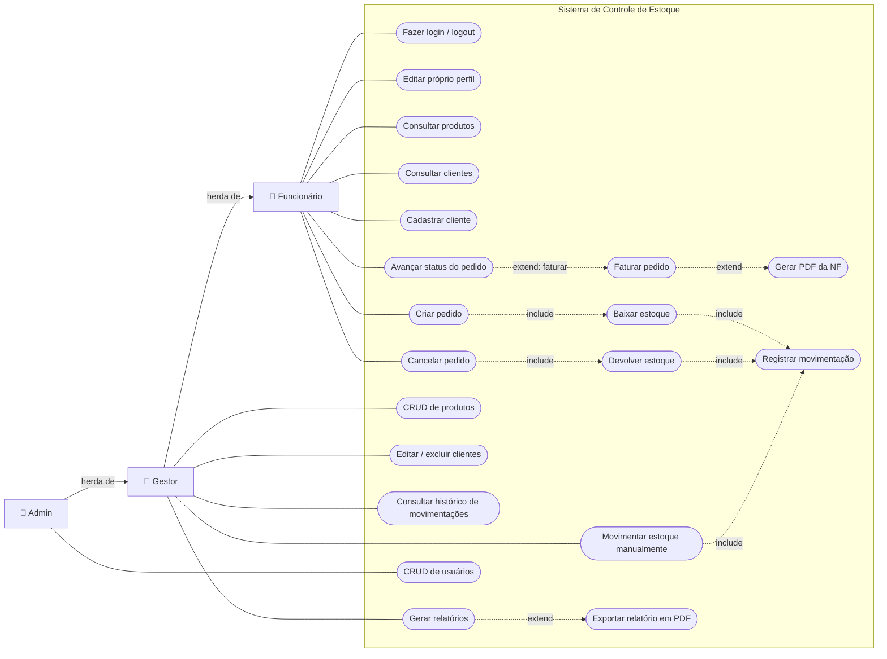

# Diagramas do projeto

Sistema de Controle de Estoque (ERP Simplificado).

## Diagrama de classes

## Diagrama de casos de uso

Os papéis herdam permissões: o **Gestor** pode tudo o que o **Funcionário** pode, e o **Admin** pode tudo o que o **Gestor** pode.

